# Physics weighting in the PhysicsNeMo physics-informed Darcy FNO

A controlled study of one hyperparameter of NVIDIA PhysicsNeMo's physics-informed Darcy flow example: the weight of the PDE residual term in the training loss. The model, the residual operator and the training loop are NVIDIA's. This repository adds the experiment around them: a check of what the training data and the residual actually represent, a sweep of the physics weight with a data-only baseline, separate records of the data and PDE terms, evaluation on a held-out test set, and figures. At the upstream training budget it also compares four discretisations of the residual and three sizes of the labelled training set, with and without unlabelled permeability fields.

The question:

> How does the weight of the physics term change the prediction error and the PDE residual of the trained operator?

and, at the upstream budget:

> Does physics-informed training improve the accuracy of the predicted Darcy pressure compared with data-only FNO training, and under which conditions?

## Summary

- The upstream example trains a Fourier Neural Operator (FNO) with the loss `MSE + (physics_weight / 240) * mean|PDE residual|`. The residual is computed with finite differences on the output grid (the PINO approach), not with automatic differentiation.
- The forcing term of the upstream residual does not match the dataset. In the normalised variables the data satisfy $-\nabla\cdot(k'\nabla u') = 57.2$; the upstream script uses $0.0175$, the reciprocal. The reference solutions of the dataset therefore have a residual of 56.7 in almost every cell under the upstream definition.
- The study sweeps the physics weight for both definitions: the residual **as shipped** (the upstream behaviour) and a **data-consistent** residual (corrected forcing and grid spacing), with one shared data-only model.
- In the reduced local study (15 epochs, one seed), the residual as shipped lowers its own residual and raises the prediction error at every weight from 0.01 upwards: relative $L^2$ error 0.052 at the upstream default weight 0.1 and 0.098 at weight 1, against 0.048 for the data-only model.
- The data-consistent residual lowers the residual by a factor of 9 at weight 0.1 with similar prediction error (0.0475 against 0.0480). At weight 1 the error rises to 0.054.
- A lower mean residual is not the same as agreement with the reference. With the data-consistent residual at weights 0.1 and 1, the trained models have a smaller mean residual than the reference solutions of the dataset, with the largest residual reductions near permeability changes.
- At 15 epochs, over three training seeds (0, 1, 2) at weight 0.1, the residual reduction reproduces in every seed, under the training residual and under the exact discrete operator that generated the data. The shipped residual raised the error in all three seeds (mean +0.0040, or +8 %; 95 % interval over seeds -0.0002 to +0.0081). The data-consistent residual did not change the error detectably (mean -0.0004; interval -0.0070 to +0.0061; lower in two seeds, higher in one). A lower residual did not translate into a lower error.
- At the upstream training budget (5100 optimiser steps, 50 epochs of 102 samples, three seeds, trained on Apple MPS rather than CUDA), physics-informed training improves accuracy, under conditions:
  - **Weight.** With the data-consistent residual at weight 0.1 the test error falls from 0.0377 to 0.0295, by 21.7 % (95 % interval over seeds 16.3 % to 27.1 %), lower in every seed; with five seeds by 21.6 % (19.6 % to 23.5 %). At weight 0.01 the reduction is 11.5 %; at weight 1 no change is detectable. The residual as shipped has no material effect at the upstream default 0.1 (five seeds, -1.1 %, interval -3.8 % to +1.5 %) and more than doubles the error at weight 1.
  - **Discretisation.** A residual built on the exact discrete operator and coefficient that generated the data (the reference pressure satisfies it to 0.13 % of the forcing) lowers the error by 19.4 %, no more than the simpler cell-grid residual. All four residual variants tested improve the error by 18 % to 22 %.
  - **Labels.** With 25 or 50 labelled samples the residual lowers the error by 27 % and 30 %; adding the remaining training permeabilities without their pressure as inputs of the residual, by 42 % and 39 %. The residual does not replace labels: 50 labelled samples with the residual (0.045) remain less accurate than 102 without it (0.038).
  - **Residual and accuracy differ.** The residual keeps falling as the weight grows while the error rises again beyond 0.1; the data-only model fits its training samples most closely and generalises worst.
- The 15-epoch conclusions above do not carry over to the upstream budget. At 15 epochs the data-consistent residual had no detectable effect and raised the error near permeability jumps; at 50 epochs it lowers the error everywhere, including near jumps.

## Problem

Steady Darcy flow on the unit square with zero pressure on the boundary:

$$-\nabla\cdot\big(k(\mathbf{x})\,\nabla u(\mathbf{x})\big) = f, \qquad \mathbf{x}\in(0,1)^2, \qquad u = 0 \ \text{on the boundary}, \qquad f = 1 .$$

The operator to learn maps the permeability field to the pressure field, $k \mapsto u$, on a fixed grid.

### Data

The example uses the `Darcy_241` dataset released with the FNO paper (Li et al., 2021), file `piececonst_r241_N1024_smooth1`: 1024 samples on a 241 × 241 grid. It is downloaded at run time and is not part of this repository. The PhysicsNeMo `Darcy2D` Warp generator is not used by this example.

| Split | Samples | Origin |
|---|---|---|
| training | 0 to 101 | upstream `download_data.py` (10 %) |
| validation | 102 to 203 | upstream `download_data.py` (10 %) |
| test | 204 to 459 | added here; never used during training |

As upstream, fields are cropped to 240 × 240 and scaled without a shift: $k' = k / 4.49996$ and $u' = u / 3.88433\times10^{-3}$. The model input is the field `Kcoeff`, a smoothed version of the two-valued permeability (3 and 12); it equals the two-valued field on 84.8 % of the cells.

### What the data represent

`scripts/verify_data.py` checks 460 samples (the three splits) before any training. Results are in [`results/data_check.json`](results/data_check.json).

| Check | Result |
|---|---|
| Grid | The pressure in the second row from the wall is 2.97 times that in the first row. A field that vanishes on the wall gives 3 on a cell-centred grid, so the nodes are cell centres with spacing 1/241. |
| Forcing | Where the permeability is locally constant, $-k\,\Delta_h u = 1.00000$ (standard deviation $3\times10^{-4}$) with $h = 1/241$, and $0.99172$ with $h = 1/240$. |
| Normalised forcing | $1 / (4.49996 \times 3.88433\times10^{-3}) = 57.21$. The upstream script sets $4.49996 \times 3.88433\times10^{-3} = 0.01748$. |
| Near permeability changes | On the 16 % of cells whose stencil sees a varying permeability, none of the five-point discretisations tested (expanded form, conservative form with arithmetic or harmonic face means, with either permeability field) reproduces the reference: the mean absolute residual there is at least 2.8 in units of the forcing. |

The last row sets a limit on what a residual can measure here: the reference solutions themselves do not have a small finite-difference residual near permeability changes.

`scripts/verify_reference.py` identifies the cause. A re-implementation of the original FNO solver (`solve_gwf.m`: the coefficient is spline-interpolated from the cell centres to a node grid of spacing 1/240, the conservative five-point scheme is solved there, and the solution is spline-interpolated back) reproduces the stored pressure of all 460 samples to a relative $L^2$ difference of $2.5\times10^{-8}$, the float32 rounding level, when applied to the two-valued field `coeff`. Applied to `Kcoeff`, the model input that both residuals of this study use as the coefficient, it gives a pressure that differs by 1.7 % on average. The reference therefore solves a known discrete problem exactly, including at permeability changes; its large residual there reflects a different operator and coefficient, not an inaccurate reference. Results are in [`results/audit/reference_check.json`](results/audit/reference_check.json) and [`docs/SCIENTIFIC_AUDIT.md`](docs/SCIENTIFIC_AUDIT.md).

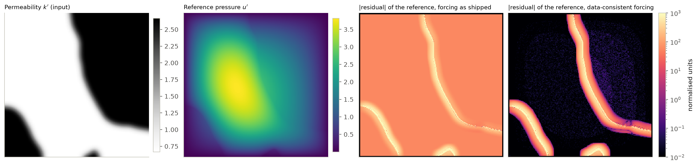

*One test sample. Third panel: the residual of the reference pressure with the forcing as shipped is close to 56.7 everywhere. Fourth panel: with the data-consistent forcing it is at rounding level where the permeability is constant and large along the permeability changes.*

## Method

### Architecture

The PhysicsNeMo `FNO` with the upstream settings: one input channel, one output channel, four Fourier layers, 32 latent channels, 12 modes per dimension, padding 9, a one-layer decoder of width 32. It has 2,365,169 trainable parameters. The upstream example also contains a DeepONet variant with automatic differentiation; it is not used here.

### Loss

For one training sample, with prediction $\hat u' = \mathrm{FNO}(k')$:

$$L = \underbrace{\frac{1}{N}\sum_{ij}\big(\hat u'_{ij} - u'_{ij}\big)^2}_{L_\text{data}} \; + \; \frac{w}{240}\,\underbrace{\frac{1}{N}\sum_{ij}\big|r_{ij}\big|}_{L_\text{pde}}, \qquad N = 240^2 ,$$

$$r = -k'\,(\hat u'_{xx} + \hat u'_{yy}) - k'_x\,\hat u'_x - k'_y\,\hat u'_y - Q .$$

- $w$ is `physics_weight` in the configuration, 0.1 upstream. The factor 1/240 is hard-coded upstream, so the effective coefficient of $L_\text{pde}$ at the default is $4.2\times10^{-4}$.
- "Physics-informed" means this residual term only. The residual is built by `physicsnemo.sym.PhysicsInformer` from a symbolic `Diffusion` equation, which SymPy expands into the form above. All derivatives, including those of the permeability, are second-order central differences on the grid.
- The stencil is periodic, so the residual of the two outermost rows and columns is set to zero. Those cells still count in the mean.
- The residual is evaluated on the same training sample as the data term. There are no separate collocation points, no unlabelled inputs and no boundary loss.
- The data term is a mean squared error and the PDE term a mean absolute error, so the two are not on the same scale.
- Batch size is 1, as upstream. The finite-difference module of `PhysicsInformer` differentiates only the first sample of a batch, so the code rejects larger batches.

### Two residual definitions

| Name | Forcing $Q$ | Spacing | Meaning |
|---|---|---|---|
| `shipped` | 0.01748 | 1/240 | the two expressions of the upstream script, unchanged |
| `consistent` | 57.21 | 1/241 | the values the dataset satisfies |

Mean absolute residual of the **reference solutions** of the test set, in normalised units:

| Definition | All cells ($L_\text{pde}$) | Cells with constant permeability | Other cells |
|---|---|---|---|
| `shipped` | 78.7 | 56.7 | 209.1 |
| `consistent` | 26.0 | 0.015 | 165.9 |

Both are far from zero. For `shipped` the cause is the forcing. For `consistent` the whole contribution comes from the cells near permeability changes.

### Residual formulations of the 50-epoch studies

The 50-epoch studies add three residuals with the corrected forcing, written for this study (`src/pino_darcy/discrete.py`). They differ in the operator and in the coefficient. Mean absolute residual of the stored reference pressure, as a fraction of the forcing, on the first 16 training and test samples ([`results/audit/solver_operator_check.json`](results/audit/solver_operator_check.json)):

| Name | Operator | Coefficient | Reference residual / forcing |
|---|---|---|---|
| `consistent` | cell-grid central differences, as above | `Kcoeff` | 0.41 to 0.45 |
| `consistent_coeff` | cell-grid central differences | `coeff` | 0.11 |
| `solver_kcoeff` | conservative five-point scheme of the generating solver on the node grid, with spline maps between grids | `Kcoeff` | 0.45 to 0.50 |
| `solver` | the same | `coeff` | 0.0013 |

`solver` is the discrete problem the reference pressure solves; its torch implementation agrees exactly with the NumPy re-implementation of the solver in double precision, and its gradient agrees with central differences. Six nodes next to the cropped edge are left out of it.

### Experiment

One factor is varied, the physics weight $w \in \{0, 0.001, 0.01, 0.1, 1\}$, for each residual definition. Weight 0 is the data-only model; it does not depend on the residual definition and is trained once per seed, without evaluating the residual. The range was chosen from the measured magnitudes. At the end of training $L_\text{data}$ is between 0.004 and 0.03 and $L_\text{pde}$ between 7 and 100, so the weighted PDE term is about a tenth of the data term at $w = 0.001$ and 2.3 (`consistent`) to 3.4 (`shipped`) times the data term at $w = 1$. At the upstream default ($w = 0.1$, `shipped`) it is already 2.2 times the data term.

Architecture, data, batch size, optimiser (Adam, learning rate $10^{-3}$, exponential decay after every step) and seed are the same for all runs of a study.

| Configuration | Purpose | Epochs | Seeds | Runs |
|---|---|---|---|---|
| `official` | upstream default: `shipped`, weight 0.1 | 50 | 1 | 1 |
| `smoke` | pipeline check on a small model and 8 samples | 2 | 1 | 3 |
| `local` | reduced study for a laptop | 15 | 1 | 9 |
| `full` | study at the upstream budget, CUDA (not run) | 50 | 3 | 27 |
| `full_mps` | upstream budget on MPS: data only, `shipped` 0.1, `consistent` 0.1 | 50 | 3 + 2 | 9 + 6 |
| `full_mps_sweep` | both residuals at weights 0.001, 0.01, 1 | 50 | 3 | 18 |
| `full_mps_operator` | coefficient and operator of the residual, weight 0.1 | 50 | 3 | 9 |
| `full_mps_solver_w1` | exact-operator residual at weight 1 | 50 | 3 | 3 |
| `labels25`, `labels50` | 25 or 50 labelled samples: data only and `solver` 0.1 | 204, 102 | 3 | 12 |
| `labels25_unlabelled`, `labels50_unlabelled` | as above, plus the other training permeabilities without pressure | 204, 102 | 3 | 6 |

`local` compresses the learning-rate schedule so that the rate falls by the same factor (0.073) over 15 epochs as it does upstream over 50. `full` trains exactly as `official`; its run `shipped_w0.1_seed0` is the upstream default configuration. The `full_mps` family trains as `full` (5100 optimiser steps, upstream schedule) on Apple MPS; the label studies keep 5100 steps by running more epochs. Their analysis plans, [`docs/FULL_BUDGET_PLAN.md`](docs/FULL_BUDGET_PLAN.md) and [`docs/OPERATOR_AND_LABELS_PLAN.md`](docs/OPERATOR_AND_LABELS_PLAN.md), were committed before any of their runs.

### Metrics

- Relative $L^2$ error of the pressure on the test set, per sample, then averaged. It is the same in normalised and physical units.
- Mean squared error in normalised units (the data loss).
- Mean absolute residual under both definitions, for every model whatever it was trained with, and for the reference solutions. Also the root mean square, the signed mean, and the mean over cells with constant permeability and over the other cells.
- Parameter count, training time, inference time, and peak CUDA memory when the device is CUDA.

## Results

Two budgets, both on an Apple M3 Pro. At the upstream budget (5100 optimiser steps): the weight sweep, the residual formulations and the label budget, three seeds each. At a reduced budget (15 epochs): the weight sweep with one seed and a seed study at weight 0.1. The CUDA configuration `full` is provided for a replication and has not been run. Experiment records and execution details are described in [`results/README.md`](results/README.md).

### Upstream budget (50 epochs)

Every run has 5100 optimiser steps with the upstream learning-rate schedule, three seeds (0, 1, 2), the same 256 test samples, and was trained on an Apple M3 Pro with MPS. Differences are paired by seed against the data-only model with the same labelled samples; the brackets are 95 % Student-t intervals over seeds (2 degrees of freedom), as relative changes. Readings follow the pre-registered rule (improvement if the interval lies below zero, degradation if above, no material effect if within ±5 % of the control error, otherwise inconclusive) on the unadjusted interval; the Holm-adjusted p value is over the family of each comparison. Primary comparisons: `consistent` 0.1 (G2), `solver` 0.1 (G4) and the four comparisons with fewer labels (G5, G6). The training-split error was not evaluated for the weight sweep (n/a). Analysis: `scripts/full_study.py`, output in [`results/audit/full_study.json`](results/audit/full_study.json); interpretation and caveats in [`docs/SCIENTIFIC_AUDIT.md`](docs/SCIENTIFIC_AUDIT.md), F15 to F17.

| Labelled samples | Trained with | Test rel. $L^2$ | SD over seeds | Near jumps | Train rel. $L^2$ | Difference to data only (same labels) | Reading (Holm p) |
|---|---|---|---|---|---|---|---|
| 102 | data only | 0.0377 | 0.0014 | 0.0489 | 0.0083 |  |  |
| 102 | `shipped` 0.001 | 0.0367 | 0.0009 | 0.0477 | n/a | -2.8 % [-6.8, +1.1] | inconclusive, 0.270 |
| 102 | `shipped` 0.01 | 0.0350 | 0.0011 | 0.0451 | n/a | -7.3 % [-10.1, -4.4] | improvement, 0.042 |
| 102 | `shipped` 0.1 | 0.0372 | 0.0004 | 0.0407 | 0.0263 | -1.4 % [-8.8, +5.9] | inconclusive, 0.487 |
| 102 | `shipped` 1 | 0.0913 | 0.0006 | 0.0768 | n/a | +142.0 % [+129.3, +154.6] | degradation, 0.003 |
| 102 | `consistent` 0.001 | 0.0367 | 0.0012 | 0.0476 | n/a | -2.8 % [-5.4, -0.2] | improvement unadjusted only, 0.170 |
| 102 | `consistent` 0.01 | 0.0334 | 0.0012 | 0.0442 | n/a | -11.5 % [-14.1, -9.0] | improvement, 0.016 |
| 102 | `consistent` 0.1 | 0.0295 | 0.0012 | 0.0414 | 0.0177 | -21.7 % [-27.1, -16.3] | improvement (primary), 0.003 |
| 102 | `consistent` 1 | 0.0348 | 0.0009 | 0.0483 | n/a | -7.7 % [-18.7, +3.4] | inconclusive, 0.270 |
| 102 | `consistent_coeff` 0.1 | 0.0309 | 0.0015 | 0.0455 | 0.0198 | -18.0 % [-26.0, -10.0] | improvement unadjusted only, 0.083 |
| 102 | `solver_kcoeff` 0.1 | 0.0295 | 0.0013 | 0.0412 | 0.0174 | -21.7 % [-26.4, -17.0] | improvement, 0.022 |
| 102 | `solver` 0.1 | 0.0304 | 0.0017 | 0.0438 | 0.0187 | -19.4 % [-26.8, -12.0] | improvement (primary), 0.008 |
| 102 | `solver` 1 | 0.0370 | 0.0025 | 0.0495 | 0.0335 | -1.9 % [-24.0, +20.1] | inconclusive, 1.000 |
| 50 | data only | 0.0652 | 0.0051 | 0.0805 | 0.0039 |  |  |
| 50 | `solver` 0.1 | 0.0454 | 0.0029 | 0.0594 | 0.0136 | -30.3 % [-39.9, -20.8] | improvement (primary), 0.021 |
| 50 | `solver` 0.1 + unlabelled | 0.0401 | 0.0020 | 0.0527 | 0.0146 | -38.5 % [-57.6, -19.5] | improvement (primary), 0.026 |
| 25 | data only | 0.0909 | 0.0097 | 0.1103 | 0.0022 |  |  |
| 25 | `solver` 0.1 | 0.0666 | 0.0072 | 0.0880 | 0.0106 | -26.7 % [-36.3, -17.0] | improvement (primary), 0.021 |
| 25 | `solver` 0.1 + unlabelled | 0.0528 | 0.0047 | 0.0687 | 0.0110 | -42.0 % [-63.2, -20.7] | improvement (primary), 0.026 |

The pre-registered stopping rule asked for two more seeds of the primary G2 comparison (the interval over three seeds was wider than ±5 % of the data-only error). With five seeds (0 to 4) the data-consistent residual at weight 0.1 lowers the error from 0.0383 to 0.0300: -21.6 % [-23.5, -19.6], lower in all five seeds, with the same estimate as over three seeds and an interval about three times narrower. The residual as shipped at the upstream default 0.1 has no material effect over five seeds (-1.1 % [-3.8, +1.5]). The per-seed intervals over test samples (half-width about 0.0012) hold one pair of trained models fixed and are not used as evidence about a setting.

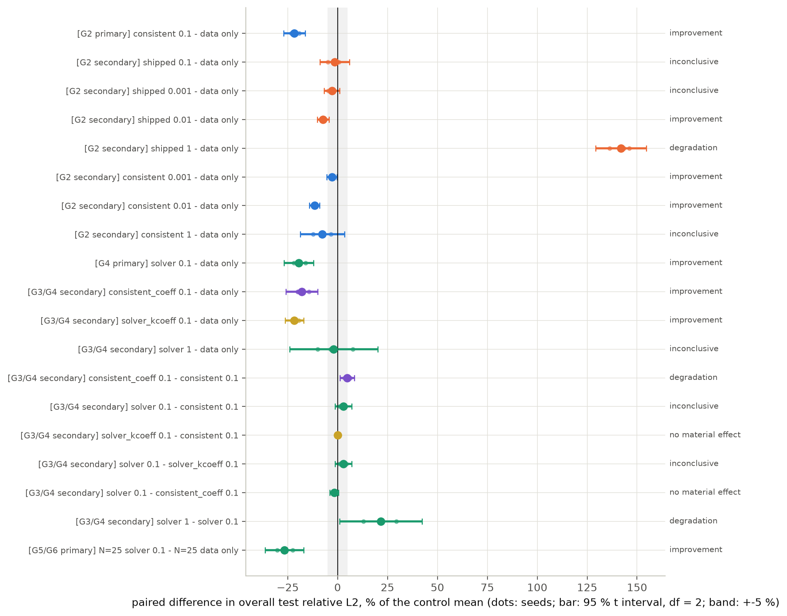

**Weight.** The data-consistent residual lowers the error at every weight up to 0.1, most at 0.1, and has no detectable effect at weight 1, although its residual is lowest there. The residual as shipped helps only at weight 0.01, has no detectable effect at the upstream default 0.1, and more than doubles the error at weight 1, because its forcing contradicts the data.

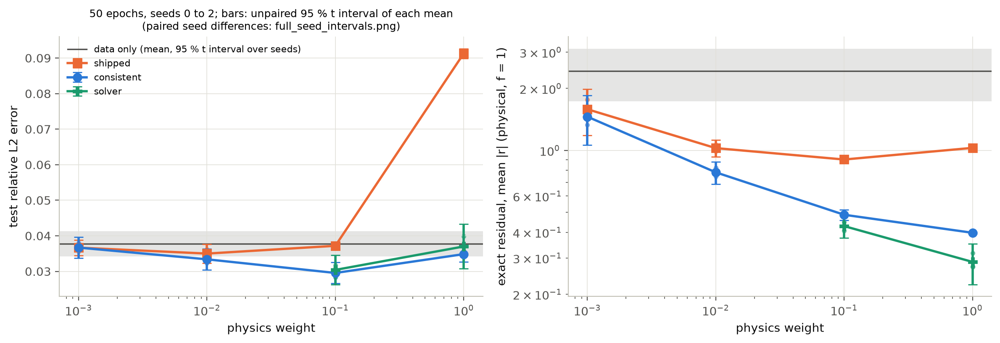

**Residual formulation.** Two choices were crossed at weight 0.1: the operator (the cell-grid central differences of the upstream residual, or the conservative node-grid scheme of the solver that generated the data) and the coefficient (`Kcoeff`, the network input, or the two-valued `coeff` the data were generated with). The reference pressure satisfies the generator's operator with `coeff` (`solver`) to 0.13 % of the forcing and the cell-grid residual with `Kcoeff` only to 41 % to 45 %, mostly near jumps. All four improve the error by 18 % to 22 %. The exact residual is not better than the cell-grid one (+2.9 % [-1.3, +7.1]); with `Kcoeff` the operator makes no difference (+0.0 % [-1.1, +1.1]); `coeff` is slightly worse than `Kcoeff` at the cell-grid operator (+4.7 % [+1.1, +8.3], not significant after Holm). At weight 1 the exact residual, like the cell-grid one, gives no detectable improvement.

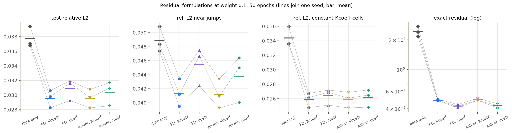

**Labels and unlabelled fields.** With fewer labels the absolute benefit of the residual grows (0.024 at 25 labels, 0.020 at 50, 0.007 at 102) and the relative benefit stays between 19 % and 30 %. Adding the training permeabilities that have no pressure label as inputs of the residual lowers the error further at 25 labels (-20.8 % [-37.0, -4.7] against `solver` 0.1 alone, not significant after Holm) and inconclusively at 50 (-11.8 % [-25.4, +1.9]). Those runs evaluate the residual twice per step and cost about twice as much compute; no compute-matched control was run.

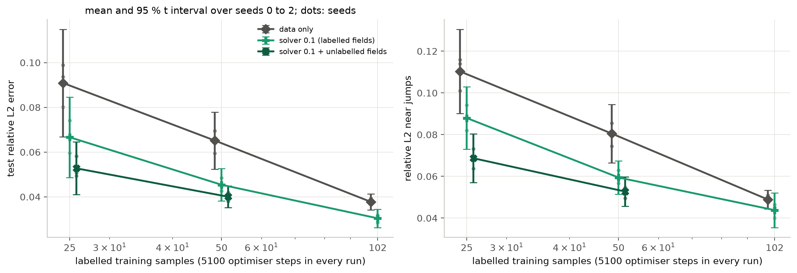

**Near permeability jumps.** At 15 epochs both weighted settings raised the error near jumps in every seed. At 50 epochs the data-consistent residual lowers it there by 15 % in every seed; the other residuals at weight 0.1 also have lower mean errors near jumps, with intervals that include zero for `consistent_coeff` and `solver`. The jump-region degradation was a property of the shorter training.

**Residual is not accuracy.** The exact residual falls monotonically with the weight (to 0.17 of the data-only value at `consistent` 1 and 0.12 at `solver` 1) while the error is lowest at 0.1. With 102 labels the training error of the data-only model (0.0083) is a fifth of its test error (0.0377); with the residual at 0.1 the gap is smaller (0.018 against 0.030), and with 25 or 50 labels the data-only model fits its labels almost exactly (0.002, 0.004) while the residual keeps the training error near 0.01. The residual acts like a regulariser here; this reading is consistent with the numbers but was not tested against other regularisers.

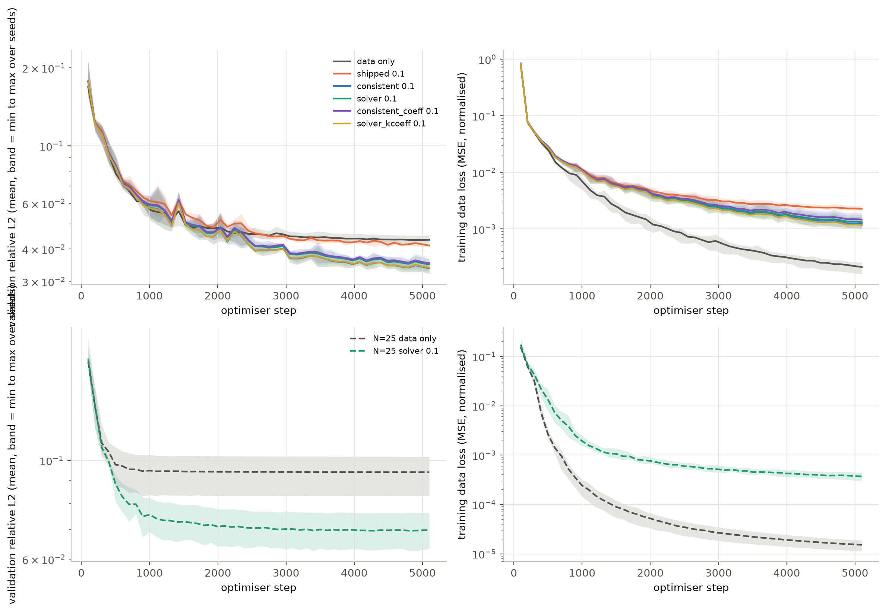

### Reduced study (15 epochs)

Test set of 256 samples, one seed, 15 epochs (1530 optimiser steps). Residuals are mean absolute values in normalised units; the reference solutions give 78.7 (`shipped`) and 26.0 (`consistent`).

| Trained with | Weight | Relative $L^2$ error | Data loss (train, last epoch) | Residual, `shipped` | Residual, `consistent` |
|---|---|---|---|---|---|
| data only | 0 | 0.0480 | 0.0043 | 156.2 | 147.5 |
| `shipped` | 0.001 | 0.0479 | 0.0043 | 105.7 | 92.6 |
| `shipped` | 0.01 | 0.0488 | 0.0050 | 63.0 | 44.9 |
| `shipped` | 0.1 (upstream default) | 0.0521 | 0.0078 | 43.8 | 35.6 |
| `shipped` | 1 | 0.0978 | 0.0330 | 27.7 | 42.0 |
| `consistent` | 0.001 | 0.0479 | 0.0044 | 101.3 | 86.7 |
| `consistent` | 0.01 | 0.0478 | 0.0051 | 64.9 | 37.9 |
| `consistent` | 0.1 | 0.0475 | 0.0070 | 56.2 | 16.1 |
| `consistent` | 1 | 0.0537 | 0.0125 | 55.1 | 8.3 |

The per-sample test error has a standard deviation of about 0.019, corresponding to a standard error of the mean near 0.0012 for an individual model. All models share the same test samples, so this individual-model uncertainty does not establish the significance of differences between models. Variation across training runs is measured in the seed study below; it is larger than the difference between 0.0480 and 0.0475.

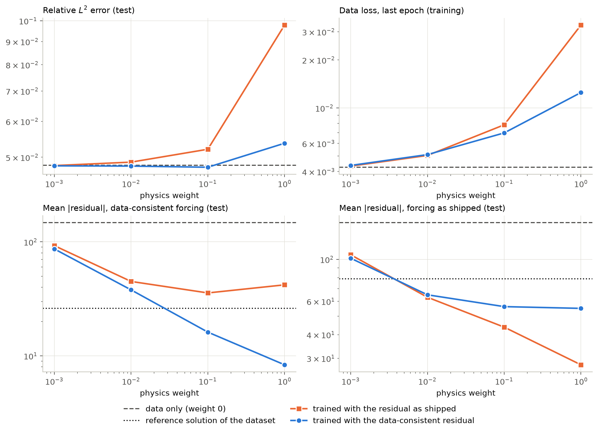

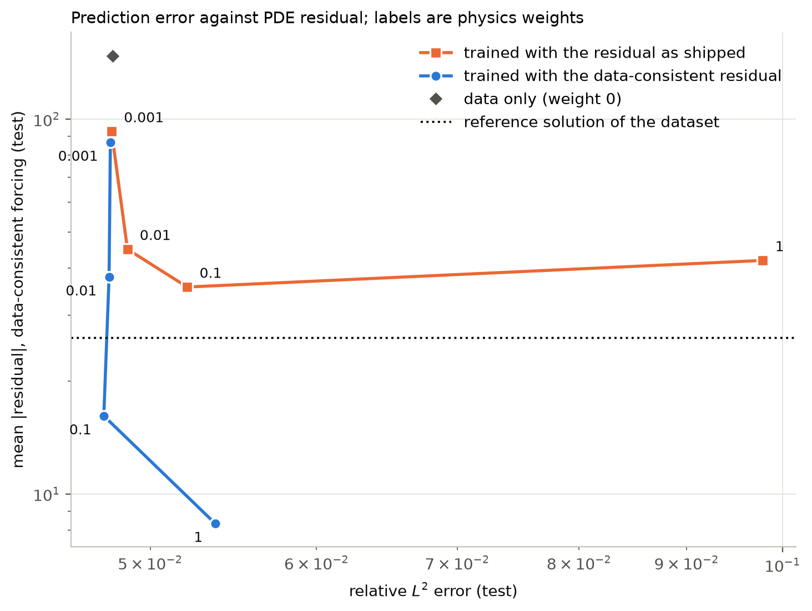

**Prediction error.** With the residual as shipped, the error is unchanged at weight 0.001 and grows with the weight: by 9 % at the upstream default 0.1 and by a factor of 2.0 at weight 1. With the data-consistent residual the error stays at the data-only level up to weight 0.1 and is 12 % higher at weight 1. At weight 0.1 the seed study below tests whether these differences reproduce.

**PDE residual.** Every physics-weighted model has a lower residual than the data-only model under both definitions, and the residual a model was trained with decreases monotonically with its weight. The data-only model has a residual of 147.5 under the data-consistent definition, 5.7 times that of the reference solutions: fitting the pressure to 4.8 % does not give a small residual, because second differences amplify small oscillations of the prediction.

**Why the shipped residual raises the error.** Under the data-consistent definition, the signed mean residual of the models trained with the shipped residual is $-7.8$, $-17.4$ and $-31.2$ at weights 0.01, 0.1 and 1, while it stays within $\pm 0.5$ for the models trained with the data-consistent residual. The shipped loss pulls $-\nabla\cdot(k'\nabla\hat u')$ from 57.2 towards 0.0175, which is a different equation from the one the pressure data satisfy, so the two loss terms compete.

**A residual below that of the reference.** At weights 0.1 and 1 the data-consistent models reach mean residuals of 16.1 and 8.3, below the 26.0 of the reference solutions. The split by cell type shows where this comes from:

| Model | Cells with constant permeability | Other cells |
|---|---|---|
| reference solutions | 0.015 | 165.9 |
| data only | 139.7 | 218.8 |
| `consistent`, weight 0.1 | 11.9 | 41.5 |
| `consistent`, weight 1 | 5.5 | 24.7 |

Where the permeability is constant, the residual of the trained models is several hundred times that of the reference. Near permeability changes it is four to seven times smaller than that of the reference. These measurements are consistent with smoothing near permeability changes, but do not by themselves identify the cause. They show that a lower finite-difference residual need not imply closer agreement with the reference pressure. In the error maps below, the largest errors of all three models lie along those changes.

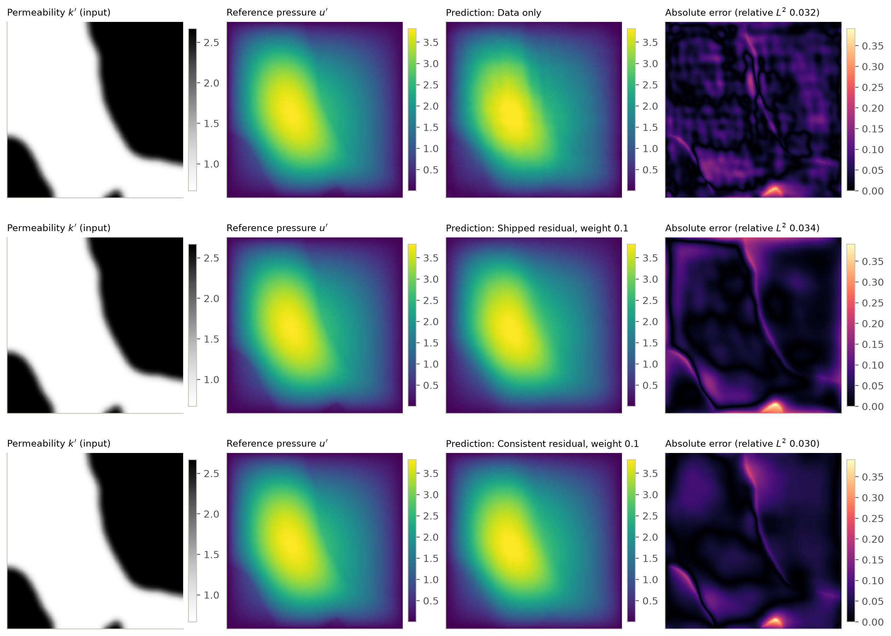

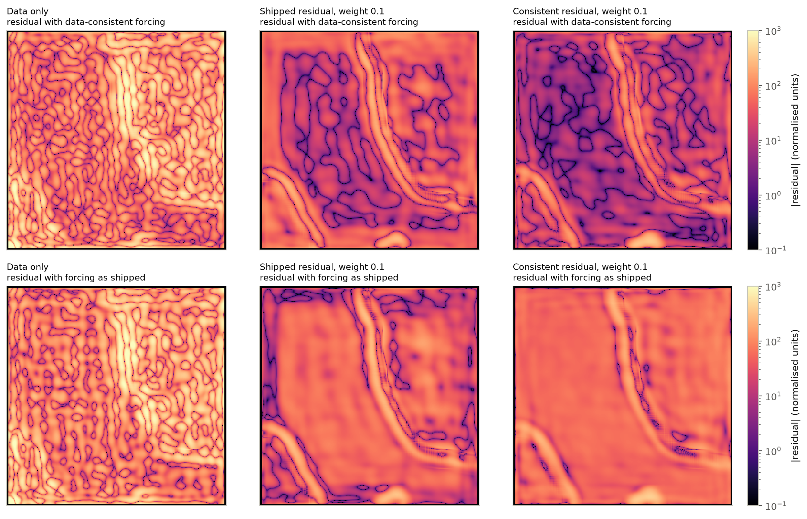

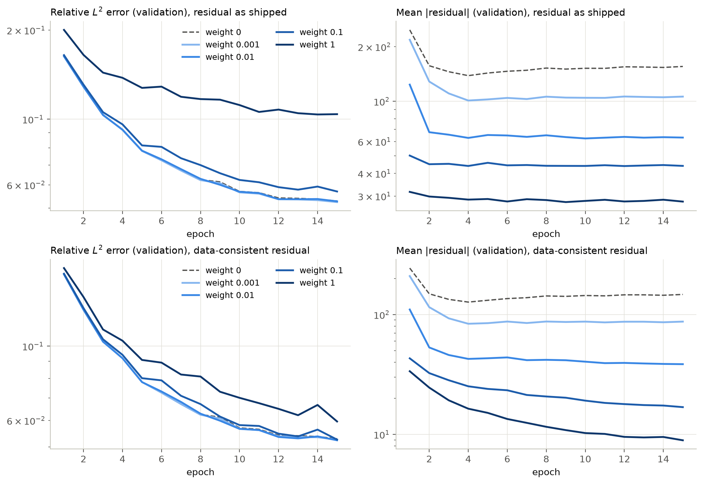

*The validation error is still decreasing at epoch 15 for every weight, so the reduced study compares models that are not converged.*

### Seed study at weight 0.1 (15 epochs)

The data-only model and both residual definitions at weight 0.1, trained with seeds 1 and 2 in addition to seed 0 (G1 of [`docs/EXPERIMENT_GAPS.md`](docs/EXPERIMENT_GAPS.md)). Everything else is identical: configuration, data split, 15 epochs, optimiser and schedule; the training settings of all nine runs have the same hash (`results/local_seeds/run_manifest.json`). The seed sets the initial weights and the sample order. Analysis: `scripts/seed_study.py`, output in `results/audit/seed_study.json`.

Two residuals are reported. The **training residual** is the cell-grid residual of the loss (data-consistent definition, smoothed `Kcoeff`, normalised units). The **exact residual** is that of the discrete problem the reference pressure solves (two-valued `coeff`, node grid, physical units; the reference scores 0.0004, see [`docs/SCIENTIFIC_AUDIT.md`](docs/SCIENTIFIC_AUDIT.md), F3).

| Setting | Seed | Relative $L^2$ error | Error, constant-permeability cells | Error, near jumps | Exact residual | Training residual |
|---|---|---|---|---|---|---|
| data only | 0 | 0.0480 | 0.0434 | 0.0623 | 2.84 | 147.5 |
| data only | 1 | 0.0504 | 0.0459 | 0.0641 | 4.87 | 282.7 |
| data only | 2 | 0.0483 | 0.0439 | 0.0622 | 1.96 | 97.4 |
| `shipped` 0.1 | 0 | 0.0521 | 0.0459 | 0.0660 | 0.896 | 35.6 |
| `shipped` 0.1 | 1 | 0.0527 | 0.0462 | 0.0679 | 0.896 | 36.5 |
| `shipped` 0.1 | 2 | 0.0539 | 0.0477 | 0.0674 | 0.890 | 36.1 |
| `consistent` 0.1 | 0 | 0.0475 | 0.0423 | 0.0645 | 0.565 | 16.1 |
| `consistent` 0.1 | 1 | 0.0474 | 0.0416 | 0.0661 | 0.587 | 18.3 |
| `consistent` 0.1 | 2 | 0.0506 | 0.0456 | 0.0660 | 0.599 | 18.2 |

Paired by seed against the data-only model of the same seed. Mean over the three seeds with a 95 % Student-t interval over seeds (2 degrees of freedom); residuals as geometric-mean ratios.

| Comparison | Error difference | Constant-permeability cells | Near jumps | Exact residual ratio | Training residual ratio |
|---|---|---|---|---|---|
| `shipped` 0.1 | +0.0040 [-0.0002, +0.0081], 3 of 3 seeds worse | +0.0022 [-0.0022, +0.0066] | +0.0042 [+0.0022, +0.0062] | 0.30 [0.10, 0.92] | 0.23 [0.06, 0.85] |
| `consistent` 0.1 | -0.0004 [-0.0070, +0.0061], 2 of 3 seeds better | -0.0013 [-0.0088, +0.0063] | +0.0027 [+0.0003, +0.0051] | 0.19 [0.06, 0.62] | 0.11 [0.03, 0.41] |

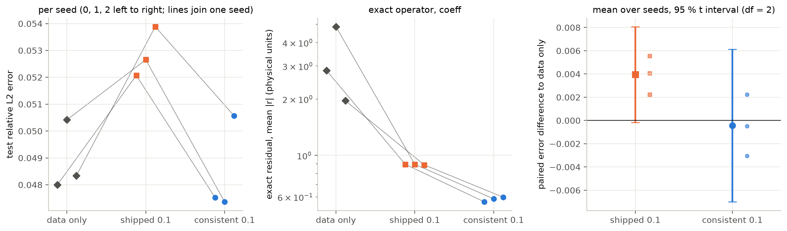

**Residual.** Both physics-weighted settings lower the residual in every seed, under both residuals. Their exact residual barely depends on the seed (0.894 ± 0.004 for `shipped`, 0.584 ± 0.017 for `consistent`, mean ± standard deviation over seeds), whereas that of the data-only model varies by a factor of 2.5 (1.96 to 4.87). The reduction factor therefore depends mostly on the data-only seed. Near jumps of `coeff` the exact residual falls only to 0.66 to 0.69 of the data-only value.

**Error.** The data-only error varies between seeds with a standard deviation of 0.0013 (2.7 %). The data-consistent residual changes the error by -0.0004 on average (-0.9 %), smaller than that spread, with an interval from -14 % to +13 % of the data-only error; its sign differs between seeds. The shipped residual raises the error in every seed, by 0.0022 to 0.0056 (+8 % on average); with three seeds the interval just includes zero (t-test p = 0.054, and an exact sign test cannot fall below 0.25). Near permeability jumps both weighted settings raise the error in every seed (+0.0027 for `consistent`, +0.0042 for `shipped`, intervals excluding zero); away from jumps the data-consistent residual lowers it in two seeds and raises it in one.

**Single-seed intervals mislead.** The per-seed bootstrap over test samples of the `consistent` minus data-only difference excludes zero in opposite directions for seed 1 (-0.0031 [-0.0041, -0.0020]) and seed 2 (+0.0022 [+0.0013, +0.0032]). Intervals over test samples describe one pair of trained models and do not measure the effect of the training setting.

### Compute

Apple M3 Pro, PyTorch 2.14.1, PhysicsNeMo 2.3.0a0, Warp 1.18.0. The FNO ran on MPS and the residual on CPU (see the adaptations below). The nine runs took 358 to 477 s each, 67 minutes of training in total, at 171 to 238 ms per optimiser step. Other jobs were running on the machine, so these times, and the inference times in the result files, are indicative only and are not compared between settings.

The six additional runs of the seed study took 148 to 203 s each, 17.7 minutes of training in total (19.5 minutes including evaluation), at 64 to 90 ms per optimiser step, under the same software versions. The machine was less loaded than during the weight sweep, so the times of the two studies are not comparable.

The 63 runs at the upstream budget took 10.3 hours of training in total on the same machine (469 to 953 s per run; 61 to 145 ms per optimiser step, the upper end for the runs with unlabelled fields), with PyTorch 2.14.1 and the same PhysicsNeMo commit. The machine was shared with other projects' jobs through the accelerator lock, so timings are indicative only.

## What NVIDIA provides and what this repository adds

Upstream: [NVIDIA/physicsnemo](https://github.com/NVIDIA/physicsnemo), commit `b45a5c810c741e6b41f8515be24c51121f8fc21f` (version 2.3.0a0), example `examples/cfd/darcy_physics_informed`, script `darcy_physics_informed_fno.py`, configuration `conf/config_pino.yaml`.

Used from the PhysicsNeMo package without modification: the `FNO` model, `PhysicsInformer`, the `PDE` base class, the finite-difference derivatives, and checkpoint saving and loading.

Adapted from the example, with the NVIDIA licence header kept and the changes stated in each file:

| File | Origin | Changes |
|---|---|---|
| `configs/official.yaml` | `conf/config_pino.yaml` | upstream file unchanged; study keys added below a marker |
| `src/pino_darcy/physics.py` | `utils.py`, `darcy_physics_informed_fno.py` | `Diffusion` class copied; forcing and spacing selectable by name; residual per sample; residual statistics |
| `src/pino_darcy/model.py` | `darcy_physics_informed_fno.py` | model construction moved into a function |
| `src/pino_darcy/engine.py` | `darcy_physics_informed_fno.py` | seeding, device selection, in-memory data, no residual evaluation at weight 0, metrics, timing, records, loop over runs |
| `src/pino_darcy/data.py` | `utils.py`, `download_data.py` | same file, constants, crop and first two splits; direct conversion to split files; test split; checksums |

Adaptations that change behaviour relative to the upstream script:

- A seed is set for model initialisation and sample order. Upstream sets none.
- On Apple MPS the residual is evaluated on CPU, because the finite-difference derivatives dispatch to NVIDIA Warp, which supports CPU and CUDA. Gradients pass through the transfer. On CUDA and CPU everything stays on one device, as upstream.
- The per-epoch validation figure and the console logger of the original are not used.

Written for this study: the dataset check, the second residual definition, the physics-weight sweep and its baselines, the evaluation and summary code, the figures, the tests, the configurations other than `official`, and the Kaggle launcher.

### Observations about the upstream example

At the commit above:

1. The forcing constant in `darcy_physics_informed_fno.py` is the product of the two normalisation constants where the scaled equation requires its reciprocal (0.0175 instead of 57.2).
2. `fd_dx = 1 / 240` differs from the grid spacing of the data, 1/241, which changes second derivatives by 0.8 %.
3. `GradientsFiniteDifference` uses `u[0, 0]`, so with a batch larger than one only the first sample would enter the residual. The example uses batch size 1 and is not affected.

## Repository structure

```text
configs/      official (upstream), smoke, local, full, full_mps*, labels*, full_cuda*
src/pino_darcy/
  data.py       download, splits, normalisation
  physics.py    Diffusion PDE, residual definitions, residual statistics
  model.py      FNO construction
  engine.py     training and evaluation of one run
  study.py      loop over residuals, weights and seeds; summaries
  plotting.py   figures
  provenance.py environment and version records
  reference.py  re-implementation of the data-generation solver, exact discrete residual
  discrete.py   differentiable torch residuals on the solver's node grid
  metrics.py    paired statistics
  gpulock.py    machine-wide accelerator lock
scripts/      prepare_data, verify_data, verify_reference, train, evaluate,
              evaluate_solver_residual, evaluate_generalisation, plot_results, results,
              seed_study, full_study, plots_full, check_solver_operator, check_determinism,
              cuda_replication, study_status
tests/        configuration, data, model, residual, loss terms, pipeline, figures, launcher, reference solver
results/      tracked result files (see results/README.md)
figures/      figures of the tracked results
docs/         scientific audit, upstream comparison, experiment gaps, checklist
kaggle/       run_cuda.ipynb, launcher for a CUDA session
```

## Installation

Python 3.11 to 3.14. PhysicsNeMo is installed from the pinned commit with its `sym` extra.

```bash
git clone https://github.com/AdebanjiAdelowo/physicsnemo-pino-darcy.git
cd physicsnemo-pino-darcy
python -m venv .venv && source .venv/bin/activate
pip install -r requirements.txt
```

## Reproducing the experiments

```bash
python scripts/prepare_data.py        # downloads Darcy_241.zip (0.8 GB), writes the three splits
python scripts/verify_data.py         # results/data_check.json, figures/data_check.png
python scripts/verify_reference.py    # results/audit/reference_check.json
python -m pytest -q                   # 88 tests, no training run needed
python scripts/train.py --config smoke device=cpu
python scripts/train.py --config local            # reduced study, trains and evaluates
python scripts/plot_results.py --study runs/local --out runs/local/figures
python scripts/train.py --config local name=local_seeds "study.seeds=[1,2]" "study.residuals=[shipped,consistent]" "study.physics_weights=[0,0.1]" evaluation.plot_samples=3
python scripts/evaluate_solver_residual.py --config local          # needs runs/local
python scripts/evaluate_solver_residual.py --config local name=local_seeds "study.seeds=[1,2]" "study.residuals=[shipped,consistent]" "study.physics_weights=[0,0.1]"
python scripts/results.py publish runs/local_seeds
python scripts/seed_study.py          # results/audit/seed_study.json, figures/seed_study.png
```

The studies at the upstream budget (about 10 hours of training on an M3 Pro), for each configuration in turn:

```bash
for c in full_mps full_mps_sweep full_mps_operator full_mps_solver_w1 labels25 labels50 labels25_unlabelled labels50_unlabelled; do
  python scripts/train.py --config $c
  python scripts/evaluate_solver_residual.py --config $c
  python scripts/evaluate_generalisation.py --config $c
  python scripts/results.py publish runs/$c
done
python scripts/train.py --config full_mps name=full_mps_more "study.seeds=[3,4]"   # and the same evaluation and publish steps
python scripts/check_solver_operator.py   # CPU only: results/audit/solver_operator_check.json
python scripts/full_study.py              # results/audit/full_study.json, figures/full_*.png
```

Training and evaluation on MPS or CUDA hold an exclusive lock on `~/.cache/physicsnemo/gpu.lock` (or the path in `PHYSICSNEMO_GPU_LOCK`) from before the device is used until the work is done, so that jobs of different projects on one machine do not share the accelerator. A job that finds the lock taken waits. The operating system releases the lock when the process exits, including after a failure.

If the automatic download fails, place `Darcy_241.zip` from the [FNO data folder](https://drive.google.com/drive/folders/1UnbQh2WWc6knEHbLn-ZaXrKUZhp7pjt-) in `datasets/`. Its SHA-256 is recorded in `results/data_check.json`.

Arguments after the options are Hydra overrides, for example `python scripts/train.py --config local "study.physics_weights=[0,0.1]" max_epochs=5`. `device=auto` selects CUDA, then MPS, then CPU; an explicitly requested device that is not available is an error. Runs are written to `runs/<name>/`, which is not tracked.

Every study stores the timestamp, the commit and dirty flag of this repository, the upstream commit, device, Python, PyTorch, PhysicsNeMo, Warp and SymPy versions, the resolved configuration, the dataset checksums and the residual definitions. Every run stores its residual definition, weight, seed, timings and metrics, and a per-epoch history with the data and PDE loss terms in separate columns.

### Replication on CUDA

The 50-epoch results above were trained on Apple MPS. [`docs/CUDA_REPLICATION_PLAN.md`](docs/CUDA_REPLICATION_PLAN.md) fixes, before any CUDA run, how they are replicated on an NVIDIA GPU and the criterion for the main result: the upper end of the five-seed 95 % interval of the relative change of `consistent` 0.1 against data only must lie below -5 %. The CUDA configurations `full_cuda` (seeds 0 to 2 of data only, `shipped` 0.1, `consistent` 0.1), `full_cuda_more` (seeds 3 and 4) and `full_cuda_sweep` (weights 0.001, 0.01, 1) train exactly as their MPS counterparts and write only to `runs/full_cuda*` and `results/full_cuda*`.

`kaggle/run_cuda.ipynb` checks out one commit by its full SHA, verifies the checkout, a clean tree and the installed PhysicsNeMo commit, prints hardware and versions, prepares and checks the data, runs the tests and a CUDA smoke study, and projects the runtime from a one-epoch probe. Nothing is trained unless `PLAN` is set: `"minimal"` (15 runs, the five-seed primary comparison), `"g2"` (27 runs, those of `configs/full.yaml`) or `"all"` (33 runs), and only if the projection fits the stated session budget; no configuration is ever reduced. Every study is trained with `--resume`, which skips finished runs and refuses to continue a study with a changed configuration, and is archived as soon as it is finished; a later session continues from those archives through `RESTORE_DIR`. The session then runs the audit evaluations and `scripts/cuda_replication.py`, and leaves per study `physicsnemo-pino-darcy-<study>.zip` (records), `-audit.zip` and `-eval-bundle.zip` (final checkpoints), and `cuda_replication.json`.

To integrate the results of a session (for each study `S` of the plan, e.g. `full_cuda` and `full_cuda_more`):

```bash
mkdir -p runs
cp physicsnemo-pino-darcy-$S.zip runs/$S.zip
python scripts/results.py publish runs/$S.zip                       # results/$S/; refuses to replace an existing directory
unzip -n physicsnemo-pino-darcy-$S-audit.zip -d .                   # results/audit/${S}_*.json; -n never overwrites
unzip -n physicsnemo-pino-darcy-$S-eval-bundle.zip -d .             # final checkpoints into runs/$S/ (not tracked)
python scripts/cuda_replication.py                                   # results/audit/cuda_replication.json, figures/cuda_replication.png
```

## Tests

`python -m pytest -q` runs 88 tests in about 15 seconds: the upstream part of `official.yaml` against its checksum, the equality of the training settings of `full` and `official`, split construction and normalisation on a synthetic file, the residual against an analytic solution, the two forcing constants, rejection of batches larger than one, the equality of the loss with the upstream expression, separate data and PDE columns in the history, checkpoint round trips, figure generation, static checks of the launcher, the re-implemented data-generation solver and its residual on synthetic fields, the accelerator lock across processes, the paired statistics, the agreement of the tracked seed study with its per-run records, the torch residuals on the solver grid against the NumPy solver, training with every residual formulation, and the construction of the unlabelled pool from the training split only, resuming a study (metadata written once, finished runs kept, a changed configuration refused), the CUDA configurations against their MPS counterparts, and the replication criterion and analysis, with the MPS studies standing in for CUDA.

## Limitations

- The upstream-budget studies were trained on Apple MPS, not on the CUDA hardware the upstream example targets; MPS runs repeat bitwise for the same seed on this machine (checked for one epoch), and MPS and CPU differ in the parameters after one epoch. A CUDA replication has not been run.
- Three seeds per setting (five for the primary G2 comparison) give wide intervals; secondary comparisons that are significant only before the Holm adjustment are reported as such.
- The 15-epoch studies compare models that are not converged, and their conclusions differ from those at the upstream budget.
- All settings use the upstream learning rate and schedule; a physics weight may prefer different hyperparameters (no tuning parity), and no other regulariser (early stopping, weight decay) was compared with the residual.
- Only the FNO variant with finite differences is studied. The DeepONet variant with automatic differentiation is not.
- The finite-difference residual of the reference solutions is large near permeability changes under every discretisation tested, so the mean residual is not a measure of distance to the reference, and a model can score below the reference by smoothing.
- The residual is evaluated in single precision. Second differences on this grid carry rounding noise of order 0.01 in normalised units, which is the level of the reference residual in cells with constant permeability.
- Label budgets of 25, 50 and 102 samples were tested at a fixed number of optimiser steps; the runs with unlabelled fields also cost about twice the compute per step.
- The data-consistent definition corrects the forcing and the spacing only. It keeps the upstream expanded form, the central differences of the permeability and the L1 reduction, and it uses the smoothed `Kcoeff` as the coefficient, whereas the reference was generated from `coeff`. It is therefore consistent with the data only away from permeability changes. The `solver` residual of the 50-epoch studies removes this inconsistency.
- Timings come from a machine that was running other jobs.

## Possible extensions

- The CUDA replication prepared in [`docs/CUDA_REPLICATION_PLAN.md`](docs/CUDA_REPLICATION_PLAN.md) (`kaggle/run_cuda.ipynb`).
- Controls with other regularisers and a learning-rate search per setting, to separate the effect of the residual from regularisation in general.
- A residual in conservative (flux) form, or one restricted to cells with constant permeability, to separate the forcing mismatch from the interface behaviour.
- The DeepONet variant of the example with automatic differentiation.
- Other datasets, resolutions and architectures.

## References

- Z. Li, N. Kovachki, K. Azizzadenesheli, B. Liu, K. Bhattacharya, A. Stuart, A. Anandkumar. *Fourier Neural Operator for Parametric Partial Differential Equations.* ICLR 2021. [arXiv:2010.08895](https://arxiv.org/abs/2010.08895)
- Z. Li, H. Zheng, N. Kovachki, D. Jin, H. Chen, B. Liu, K. Azizzadenesheli, A. Anandkumar. *Physics-Informed Neural Operator for Learning Partial Differential Equations.* [arXiv:2111.03794](https://arxiv.org/abs/2111.03794)
- NVIDIA PhysicsNeMo. [github.com/NVIDIA/physicsnemo](https://github.com/NVIDIA/physicsnemo)

## License

Apache License 2.0, see [LICENSE](LICENSE). Files adapted from NVIDIA PhysicsNeMo keep their original copyright notice; see [NOTICE](NOTICE). The dataset is not redistributed.
